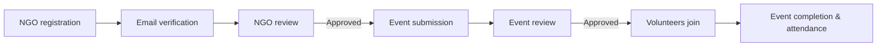

<div align="center">

<h1>🤝 Community Help Platform</h1>

<p><strong>Local causes. Shared effort. Meaningful change.</strong></p>

<p>A shared space for NGOs to organize community events,<br>volunteers to find opportunities, and administrators to keep everything moving.</p>

<p>
  <a href="https://github.com/harsha160507/CommunityHelpPlatform/actions/workflows/ci.yml"></a>
  
  
  
</p>

<p>
  <a href="#features">Features</a> ·
  <a href="#getting-started">Get started</a> ·
  <a href="#project-structure">Project structure</a> ·
  <a href="#documentation">Documentation</a> ·
  <a href="CONTRIBUTING.md">Contribute</a>
</p>

</div>

---

## About the project

Community service starts with people who want to help—and organizations that know where help is needed.

**Community Help Platform brings them together.** NGOs submit opportunities, administrators review them, and volunteers discover approved events and choose where to participate. From registration to attendance, everyone can follow the progress of an event in one place.

Built with **HTML, CSS, JavaScript, Node.js, Express, and MySQL**, the application serves its frontend and API from the same origin.

## Features

|                                  | What you can do                                                                                          |
| -------------------------------- | -------------------------------------------------------------------------------------------------------- |
| 🔎 **Discover opportunities**    | Browse approved upcoming events and the NGO directory, even before creating an account.                  |
| 🏢 **Organize community events** | Create events, set volunteer capacity, submit changes for review, and manage cancellation or completion. |
| 🙌 **Take part**                 | Register for an event, withdraw when plans change, and follow the status of your registrations.          |
| ✅ **Review with context**       | Inspect NGO and event details, approve or reject requests, and provide clear review feedback.            |
| 📋 **Coordinate volunteers**     | View organizer-only participant rosters and record attendance after an event is completed.               |
| 🔔 **Stay informed**             | Receive persistent in-app updates about participation, review decisions, and event changes.              |
| 🔐 **Manage your account**       | Verify your email, recover or change your password, update your profile, and delete your account.        |
| 📊 **See the bigger picture**    | View community counts, personal activity, and administrator review history with paginated lists.         |

### A role for everyone

| Role              | Main capabilities                                                                |
| ----------------- | -------------------------------------------------------------------------------- |
| **Guest**         | Explore approved NGOs and upcoming events.                                       |
| **Volunteer**     | Join or withdraw from events, track registrations, and manage an account.        |
| **NGO**           | Submit events, manage participants, update event details, and record attendance. |
| **Administrator** | Review NGOs and events, manage volunteer access, and inspect action history.     |

### From an idea to an event



## Getting started

### Prerequisites

- **Node.js:** 22.13+, 24, or 26.
- **MySQL:** 8.0 or later with InnoDB.
- **Git** and a modern web browser.

### 1. Clone and install

```sh
git clone https://github.com/harsha160507/CommunityHelpPlatform.git
cd CommunityHelpPlatform
npm ci
```

### 2. Prepare MySQL

Create the application database from a MySQL administrator session:

```sql
CREATE DATABASE community_help
  CHARACTER SET utf8mb4
  COLLATE utf8mb4_unicode_ci;
```

Create a dedicated database user and grant it access to this database. The account used for migrations needs schema permissions. For production, use a separate runtime account with only the permissions described in the [deployment guide](docs/DEPLOYMENT.md).

### 3. Configure the environment

Copy `.env.example` to `.env`:

```sh
# macOS / Linux
cp .env.example .env
```

```powershell
# Windows PowerShell
Copy-Item .env.example .env
```

Fill in your own database credentials and review these settings:

| Setting                  | Purpose                                                                 |
| ------------------------ | ----------------------------------------------------------------------- |
| `DB_HOST`, `DB_PORT`     | Your MySQL server address and port.                                     |
| `DB_USER`, `DB_PASSWORD` | Your dedicated database account credentials.                            |
| `DB_NAME`                | The database you created, such as `community_help`.                     |
| `BASE_URL`               | The application origin; locally, `http://localhost:3000`.               |
| `EVENT_TIMEZONE`         | The IANA timezone used for events, such as `Asia/Kolkata`.              |
| `DEV_MAIL_PREVIEW`       | Set to `true` for local verification and password-reset email previews. |

**Keep real credentials in your local environment or hosting configuration. Never commit `.env`.**

### 4. Initialize the database and administrator

```sh
npm run migrate
```

Set `ADMIN_EMAIL` and a unique, strong `ADMIN_PASSWORD` in your local environment or `.env`, then run:

```sh
npm run admin:setup
```

There are **no default administrator credentials**. Remove the bootstrap variables afterward. Running this command for an existing administrator resets its password and revokes its sessions.

### 5. Start the application

```sh
npm start
```

Open **[http://localhost:3000](http://localhost:3000)** in your browser.

For backend development with automatic restarts:

```sh
npm run dev
```

The server serves both the interface and `/api`. Open the application URL rather than the HTML file directly.

### Verify a local account

New accounts must verify their email before signing in. With development mail preview enabled, register an account and run:

```sh
npm run mail:preview
```

Open the verification link printed in your terminal. NGO accounts also need administrator approval before creating events.

Production uses SMTP instead of development previews. See the [deployment guide](docs/DEPLOYMENT.md) for delivery settings.

## Project structure

```text
CommunityHelpPlatform/
├── backend/
│   ├── src/
│   │   ├── routes/          # Account, admin, event and volunteer endpoints
│   │   ├── app.js           # Application assembly and security middleware
│   │   ├── server.js        # Startup, background mail and shutdown
│   │   ├── db.js            # MySQL access and transactions
│   │   └── validation.js    # Input and timezone rules
│   └── scripts/             # Migrations, admin setup and mail preview
├── database/
│   └── migrations/          # Versioned schema changes
├── frontend/                # HTML, CSS and browser JavaScript
├── tests/
│   ├── unit/                # Validation and configuration
│   ├── integration/         # Real-MySQL workflows and concurrency
│   └── e2e/                 # Browser and accessibility checks
├── docs/                    # API, deployment and maintenance guides
├── scripts/                 # Source and import checks
├── .github/                 # CI, dependency updates and issue templates
├── .env.example             # Configuration template
└── package.json             # Dependencies and project commands
```

## How events and accounts work

- **Approval comes first.** Public opportunities require an approved, active NGO and an approved scheduled event.
- **Registration closes at the start.** Events must begin in the future, with capacity between 1 and 10,000. Capacity is checked transactionally when volunteers join.
- **Times have a clear meaning.** Events use one configured timezone and same-day start/end times. Date-only values stay in `YYYY-MM-DD` format; ambiguous or nonexistent daylight-saving times are rejected.
- **Changes get reviewed.** NGO profile changes trigger NGO re-review; event edits trigger event re-review. Capacity cannot drop below existing registrations.
- **Participants can follow changes.** Cancellation and review status remain visible in registered events, with updates in personal activity. Volunteers can withdraw from unavailable events; completed attendance records are retained.
- **Account access is revocable.** Sessions expire after 12 hours and are revoked by logout, password changes/resets, or account disabling. Passwords require at least 12 characters and at most 72 UTF-8 bytes.
- **Participant contact details stay with the organizer.** Joining shares those details with the event's NGO.
- **Deletion removes identity fields.** Historical event/audit records remain, and scheduled NGO events are cancelled. Administrator deletion and email-address corrections are operator-managed.

## Quality checks

Run the standard checks:

```sh
npm run check
npm run lint
npm run format:check
npm test
npm audit --audit-level=high
```

For database and browser checks, create a **disposable database** whose name ends in `_test`, configure its `DB_*` settings, and set `ALLOW_TEST_DB_RESET=1`.

```sh
npm run test:integration
npx playwright install chromium
npm run test:e2e
```

> [!WARNING]
> Integration tests erase all tables in the configured test database. Never use your development or production database. Run browser tests after integration tests; they reuse that schema and start a local server on port 33418.

CI covers Node.js **22, 24, and 26** with MySQL. Browser checks run on Node.js 24 and include automated desktop/mobile accessibility checks.

## Documentation

| Guide                                          | What you will find                                                                        |
| ---------------------------------------------- | ----------------------------------------------------------------------------------------- |
| [API reference](docs/API.md)                   | Endpoints, authentication, pagination, responses, and role permissions.                   |
| [Deployment & maintenance](docs/DEPLOYMENT.md) | Production setup, SMTP, migrations, monitoring, backups, and recovery.                    |
| [Fix report](docs/FIX-REPORT.md)               | The 36 audit findings, implemented improvements, validation, and remaining owner actions. |
| [Security response](docs/SECURITY-RESPONSE.md) | Required steps for credentials exposed by earlier versions.                               |
| [Contributing](CONTRIBUTING.md)                | Development expectations and the contribution workflow.                                   |
| [Security policy](SECURITY.md)                 | How to report security concerns responsibly.                                              |

<details>
<summary><strong>Upgrading an existing installation?</strong></summary>

Back up your database and read the [deployment guide](docs/DEPLOYMENT.md) before applying migrations.

- Existing accounts must verify their email.
- Legacy administrator accounts remain disabled until explicitly reset with `npm run admin:setup`.
- Previous JWT sessions are no longer accepted.
- Any credentials exposed in earlier commits must be rotated at the actual services. Removing a file does not remove historical copies or invalidate a password.
- Production requires HTTPS, configured SMTP, and a dedicated database account.

</details>

## Contributing

Have an improvement or a reproducible bug to share? Read [CONTRIBUTING.md](CONTRIBUTING.md), open an issue, or propose a focused pull request.

Please keep credentials and personal information out of public reports.

## License

This project currently reserves its rights under [LICENSE](LICENSE); it does not grant an open-source distribution license. Third-party dependencies retain their respective licenses.

---

<div align="center">
  <strong>A little time. A shared purpose. A stronger community.</strong>
</div>
